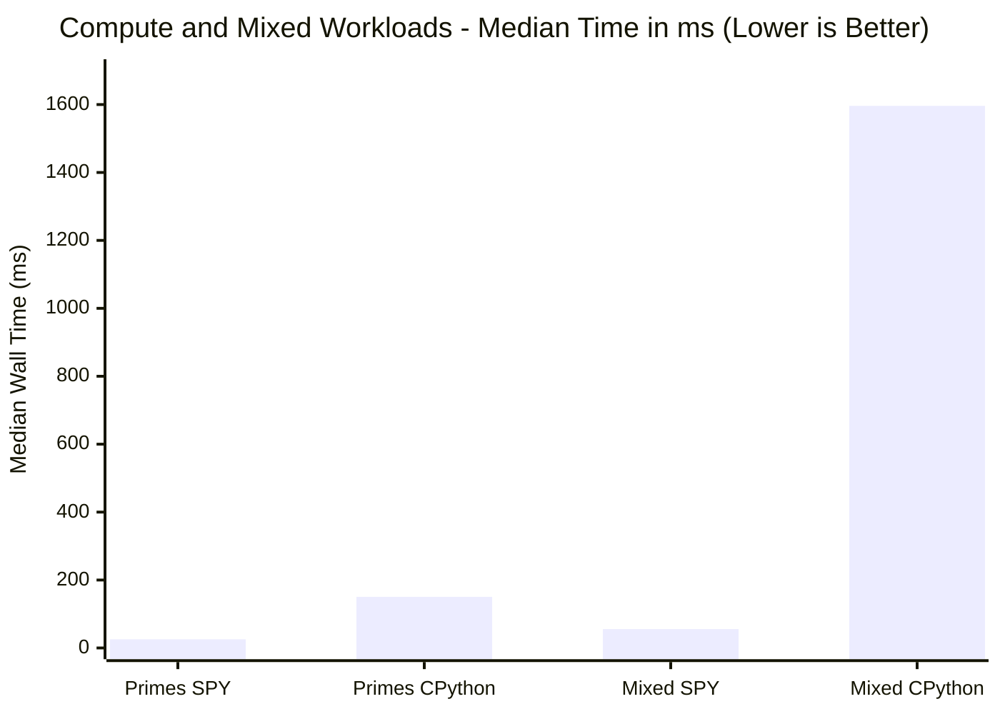
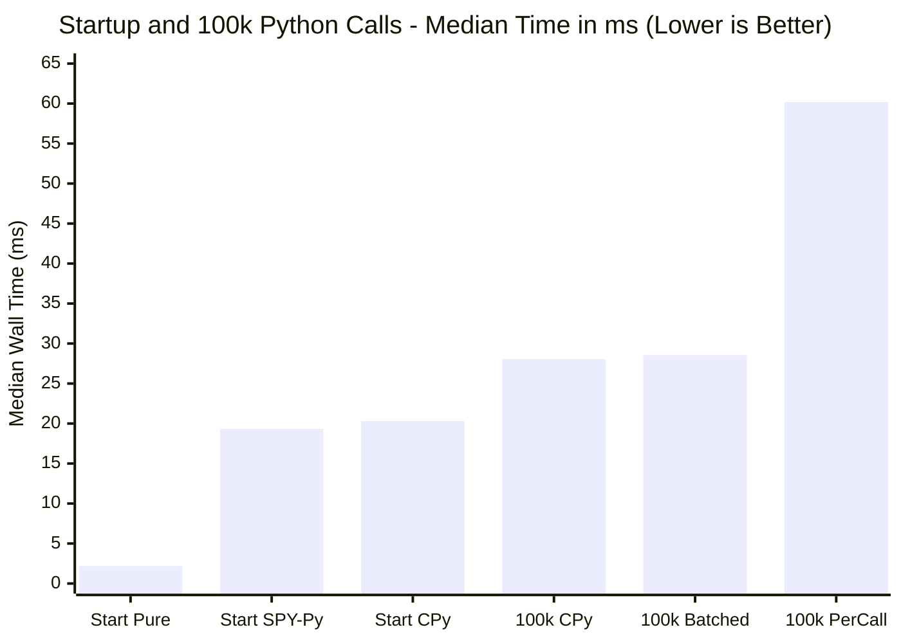
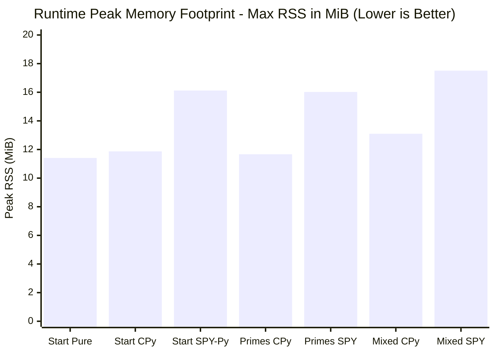
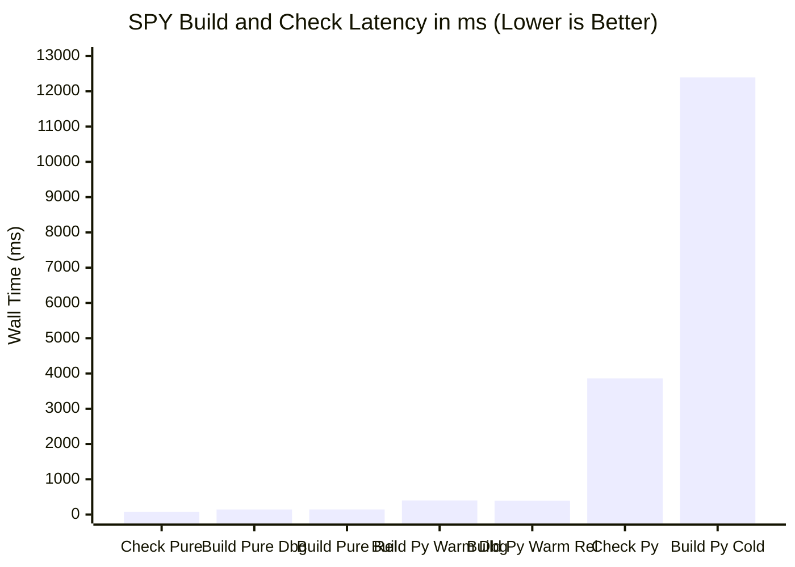

# 📊 SPY vs CPython 3.15 — Benchmark Report (Phases 0–2)

Comprehensive performance, memory, startup, and build-time comparison between **CPython 3.15.2** 🐍 and **SPY (Super Python, Phases 0–2)** 🦀 measured directly on the host environment.

---

## 🖥️ 1. Test Environment & Methodology

| Property | Value |
| --- | --- |
| **OS / Kernel** | Linux `6.18.58.1-microsoft-standard-WSL2` (`x86_64`, Ubuntu WSL2, glibc `2.43`) |
| **CPU** | Intel Core `i5-10210U` @ `1.60GHz` (8 logical cores) |
| **Rust Toolchain** | `rustc 1.100.0` (`0ef1bc386`), `pyo3 0.30.1` |
| **Python Runtime** | `Python 3.15.2` (`/home/xagi/.local/bin/python3.15`, shared `libpython3.15.so`) |
| **SPY Build Profile** | Release (`--release` via `target/release/spy`) |
| **Measurement Harness** | [run_benchmarks.py](run_benchmarks.py) using monotonic `time.perf_counter_ns()` and Linux `os.wait4` (`ru_maxrss` Peak RSS) |

- ✅ Every CPython vs SPY runtime case verifies identical `stdout` checksums/JSON output across all runs.
- 🔥 Warmup iterations precede measured iterations in every runtime benchmark.
- 🏗️ Build metrics cover both pure-Rust (`rustc`) and Python-enabled (`cargo` + `spy-runtime` + `pyo3`) compilation paths, including cold vs warm `CARGO_TARGET_DIR` cache.

---

## 📋 2. Executive Summary

| Benchmark | SPY (Median) | CPython 3.15 (Median) | Speedup vs CPython | Peak RSS (SPY / CPython) |
| --- | ---: | ---: | ---: | ---: |
| ⚡ **Startup (pure Rust)** | `2.19 ms` | `20.32 ms` | **9.27x faster** | `11.41 MiB` / `11.87 MiB` |
| 🐍 **Startup (embedded CPython)** | `19.33 ms` | `20.32 ms` | **1.05x faster** | `16.12 MiB` / `11.87 MiB` |
| 🧮 **Prime Count (`< 150,000`)** | `25.47 ms` | `150.59 ms` | **5.91x faster** | `16.02 MiB` / `11.67 MiB` |
| 🔗 **100k `math.sqrt` (batched GIL)** | `28.56 ms` | `28.05 ms` | **0.98x (on par)** | `16.03 MiB` / `11.86 MiB` |
| 🐢 **100k `math.sqrt` (`LazyPyModule` per-call)** | `60.19 ms` | `28.05 ms` | **0.47x (2.15x slower)** | `16.05 MiB` / `11.86 MiB` |
| 🚀 **Mixed: 200k Collatz + `json.dumps`** | `55.52 ms` | `1,596.10 ms` | **28.75x faster** | `17.51 MiB` / `13.10 MiB` |

---

## ⚡ 3. Execution Speed Benchmarks

### 3.1 Compute & Mixed Rust/Python Workloads

Both workloads run end-to-end as standalone processes (including CPython initialization for SPY's Python-linked binaries):

- **Prime Count (`< 150,000`)**: [cases/compute_loop.rs](cases/compute_loop.rs) vs [cases/compute_loop.py](cases/compute_loop.py) — trial division counting `13848` primes.
- **Mixed Collatz + `json.dumps` (`200,000`)**: [cases/mixed_workload.rs](cases/mixed_workload.rs) vs [cases/mixed_workload.py](cases/mixed_workload.py) — computes `22,938,602` total steps across `1..=200,000` (max `382`), then serializes via Python's `json.dumps(..., sort_keys=True)`.



```text
Prime Count (< 150k) — lower is better:
  SPY (native Rust)   | ███░░░░░░░░░░░░░░░░░░░░░░░░░░░░░   25.47 ms  (5.91x faster)
  CPython 3.15        | ████████████████████░░░░░░░░░░░░  150.59 ms

Mixed Workload (200k Collatz + Python json.dumps) — lower is better:
  SPY (Rust + json)   | █░░░░░░░░░░░░░░░░░░░░░░░░░░░░░░░   55.52 ms  (28.75x faster)
  CPython 3.15        | ████████████████████████████████ 1596.10 ms
```

| Case | Runs | Min (ms) | Median (ms) | Mean (ms) | Max (ms) | Peak RSS |
| --- | ---: | ---: | ---: | ---: | ---: | ---: |
| 🦀 **SPY — Prime Count (`< 150k`)** | 7 | `24.96` | `25.47` | `25.87` | `27.38` | `16,404 KiB` (`16.02 MiB`) |
| 🐍 **CPython 3.15 — Prime Count (`< 150k`)** | 5 | `146.30` | `150.59` | `151.03` | `157.31` | `11,948 KiB` (`11.67 MiB`) |
| 🚀 **SPY — Mixed Collatz (`200k`) + `json.dumps`** | 7 | `50.00` | `55.52` | `55.47` | `62.21` | `17,928 KiB` (`17.51 MiB`) |
| 🐍 **CPython 3.15 — Mixed Collatz (`200k`) + `json.dumps`** | 5 | `1,554.94` | `1,596.10` | `1,604.50` | `1,670.33` | `13,412 KiB` (`13.10 MiB`) |

> [!NOTE]
> Because SPY's Python-linked executable spends `~19.3 ms` initializing embedded CPython, subtracting startup shows the actual Rust prime-count compute loop runs in `~6.1 ms` vs `~130.3 ms` in CPython, and the Collatz compute loop runs in `~36.2 ms` vs `~1,575.8 ms`.

---

### 3.2 Startup & Python FFI Bridge Overhead (`100,000 × math.sqrt`)

- **Startup**: [cases/startup_pure.rs](cases/startup_pure.rs), [cases/startup_py.rs](cases/startup_py.rs), and [cases/startup_py.py](cases/startup_py.py).
- **Bridge Calls**: [cases/python_calls.rs](cases/python_calls.rs) (`per-call` via `LazyPyModule::call` vs `batched` via `SpyRuntime::try_with_gil` holding one GIL attach and cached `getattr("sqrt")`) compared against [cases/python_calls.py](cases/python_calls.py).



```text
Process Startup (15 runs) — lower is better:
  SPY (pure Rust)          | ███░░░░░░░░░░░░░░░░░░░░░░░░░░░░░   2.19 ms
  SPY (embedded CPython)   | ██████████████████████████████░░  19.33 ms
  CPython 3.15             | ████████████████████████████████  20.32 ms

100,000 × math.sqrt() Calls (5 runs) — lower is better:
  CPython 3.15 (local)     | ███████████████░░░░░░░░░░░░░░░░░  28.05 ms
  SPY (with_gil batched)   | ███████████████░░░░░░░░░░░░░░░░░  28.56 ms  (within 2% of CPython)
  SPY (LazyPyModule loop)  | ████████████████████████████████  60.19 ms  (+320 ns/call bridge cost)
```

| Case | Runs | Min (ms) | Median (ms) | Mean (ms) | Max (ms) | Peak RSS |
| --- | ---: | ---: | ---: | ---: | ---: | ---: |
| ⚡ **SPY — Pure Rust Startup** | 15 | `1.98` | `2.19` | `2.27` | `2.78` | `11,684 KiB` (`11.41 MiB`) |
| 🐍 **SPY — Embedded CPython Startup** | 15 | `18.65` | `19.33` | `19.45` | `20.97` | `16,504 KiB` (`16.12 MiB`) |
| 🐍 **CPython 3.15 Startup** | 15 | `18.68` | `20.32` | `20.48` | `22.77` | `12,152 KiB` (`11.87 MiB`) |
| 🐢 **SPY — 100k `math.sqrt` (`LazyPyModule` per-call)** | 5 | `58.14` | `60.19` | `60.45` | `62.85` | `16,436 KiB` (`16.05 MiB`) |
| 🔗 **SPY — 100k `math.sqrt` (`SpyRuntime::with_gil` batched)** | 5 | `27.65` | `28.56` | `28.81` | `30.63` | `16,416 KiB` (`16.03 MiB`) |
| 🐍 **CPython 3.15 — 100k `math.sqrt` (local binding)** | 5 | `27.27` | `28.05` | `28.75` | `31.45` | `12,140 KiB` (`11.86 MiB`) |

---

## 🧠 4. Memory Footprint (Peak RSS)



```text
Peak RSS (MiB) — lower is better:
  SPY (pure Rust startup)      | ████████████████████░░░░░░░░░░  11.41 MiB
  CPython 3.15 (startup)       | █████████████████████░░░░░░░░░  11.87 MiB
  CPython 3.15 (mixed Collatz) | ███████████████████████░░░░░░░  13.10 MiB
  SPY (embedded Py startup)    | ████████████████████████████░░  16.12 MiB  (+4.25 MiB vs CPython)
  SPY (mixed Collatz + json)   | ██████████████████████████████  17.51 MiB  (+4.41 MiB vs CPython)
```

- Embedding CPython inside a SPY binary adds a consistent `~4.2–4.4 MiB` RSS baseline over standalone `python3.15` due to mapping both the native Rust/PyO3 binary and `libpython3.15.so`.
- Peak RSS remains essentially flat (`~16.0–17.5 MiB`) across compute and FFI loops.

---

## 🏗️ 5. Build Speed & Output Binary Size



| Build Step | Wall Time | Peak Build RSS | Output Binary Size |
| --- | ---: | ---: | ---: |
| 🔍 `spy check` (pure Rust, `rustc`) | `75.3 ms` | `69,792 KiB` (`68.2 MiB`) | — |
| 🛠️ `spy build` debug (pure Rust, `rustc`) | `143.6 ms` | `87,264 KiB` (`85.2 MiB`) | `4,493,232 B` (`4.28 MiB`) |
| 📦 `spy build --release` (pure Rust, `rustc`) | `144.6 ms` | `89,156 KiB` (`87.1 MiB`) | `4,492,400 B` (`4.28 MiB`) |
| ❄️ `spy build --release` (Python, **cold cache**) | `12,394.8 ms` (`12.39 s`) | `415,484 KiB` (`405.7 MiB`) | `613,672 B` (`599.3 KiB`) |
| 🔍 `spy check` (Python, warm cache metadata) | `3,860.5 ms` (`3.86 s`) | `332,528 KiB` (`324.7 MiB`) | — |
| 🔥 `spy build` debug (Python, **warm cache**) | `401.0 ms` | `131,668 KiB` (`128.6 MiB`) | `9,927,832 B` (`9.47 MiB`) |
| 🚀 `spy build --release` (Python, **warm cache**) | `394.6 ms` | `122,816 KiB` (`119.9 MiB`) | `613,672 B` (`599.3 KiB`) |

> [!TIP]
> Because `spy-compiler` shares `CARGO_TARGET_DIR` across Python-enabled builds, `pyo3` + `spy-runtime` are compiled once (`~12.4 s` cold), and subsequent incremental debug or release builds finish in `~0.40 s` while producing compact `599 KiB` release executables.

---

## 🎯 6. Key Findings & Roadmap Takeaways

1. 🚀 **Massive wins when moving loops into native Rust**: Pure integer/algorithmic loops inside Python-linked SPY executables beat CPython 3.15 by **5.91x** on short tasks (`25.47 ms` vs `150.59 ms`) and **28.75x** on mixed Collatz + JSON (`55.52 ms` vs `1,596.10 ms`).
2. 🔗 **GIL batching eliminates per-call bridge regression**: Calling `math.sqrt` `100,000` times inside one `SpyRuntime::try_with_gil` scope with a cached attribute (`28.56 ms`) matches CPython's local loop (`28.05 ms`), whereas per-iteration `LazyPyModule::call` (`60.19 ms`) pays `~320 ns/call` for mutex module lookup + GIL re-attach + `getattr`.
3. 🛠️ **Direct optimization priorities for Phases 5 & 9**:
   - Lower loop-level Python calls inside a single GIL region wherever possible (matching `SpyRuntime::try_with_gil`).
   - Replace per-call `Mutex<HashMap>` lookups in `LazyPyModule` with `OnceLock<Py<PyModule>>` / cached attribute handles so per-call dispatch avoids mutex contention.
4. ⚡ **Fast warm builds & compact release binaries**: Warm `spy build --release` compiles Python-linked `.rs` programs in `~395 ms` to `~599 KiB` binaries with embedded `rpath`.

---

## 🧪 7. Reproducing These Benchmarks

```bash
export PATH="$HOME/.cargo/bin:$HOME/.local/bin:$PATH"
python3.15 benchmark/run_benchmarks.py
```

Raw measurements are written to [results.json](results.json).
